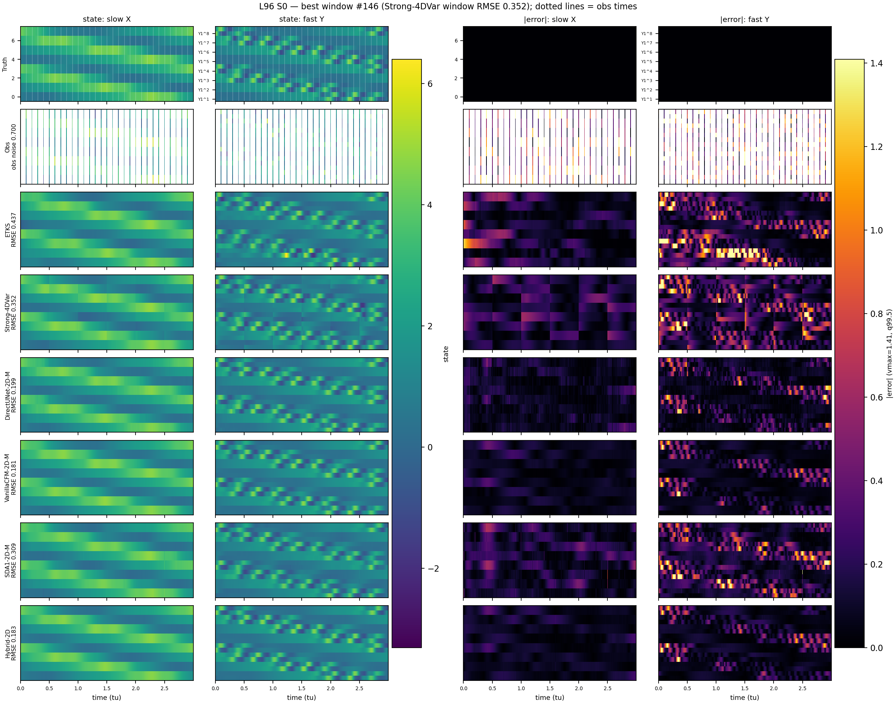
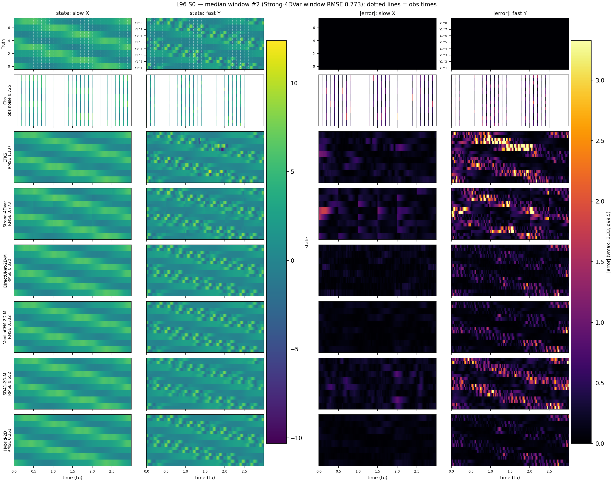
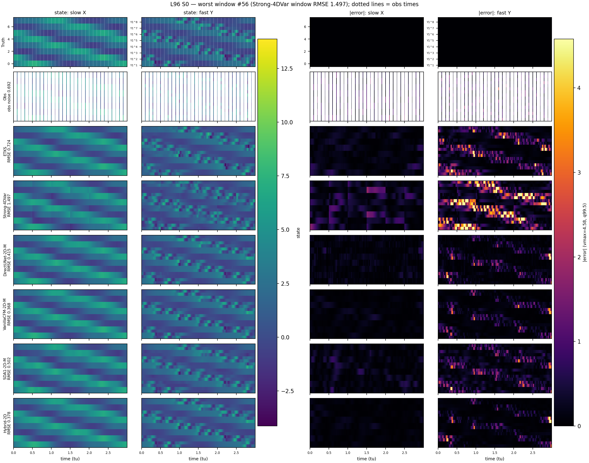
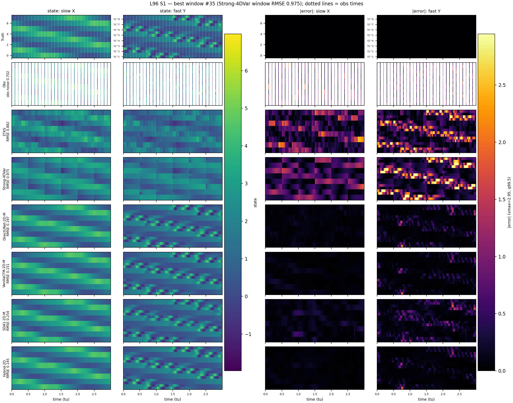
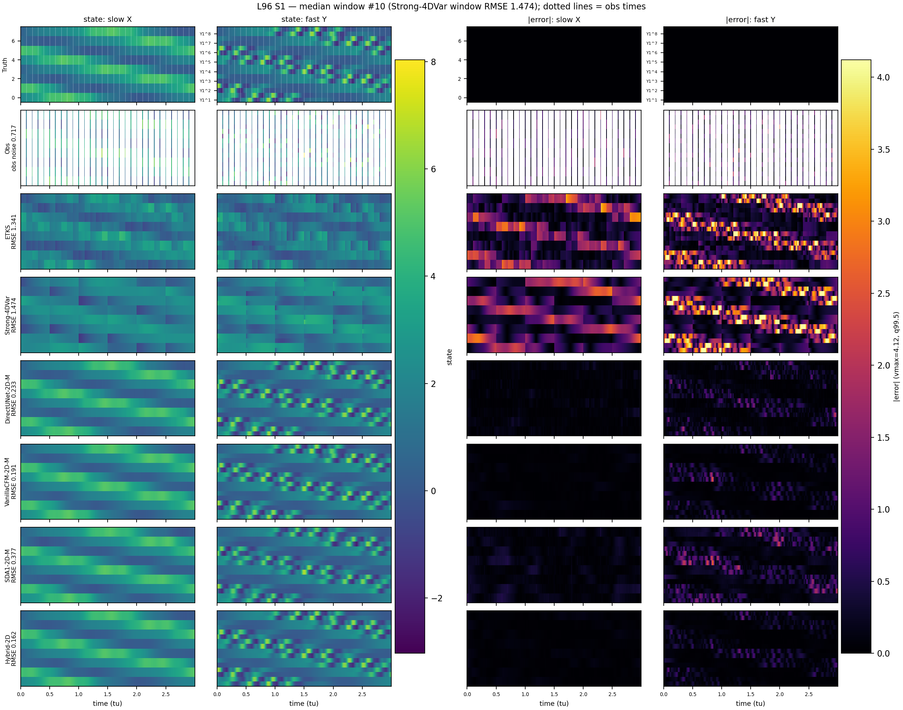
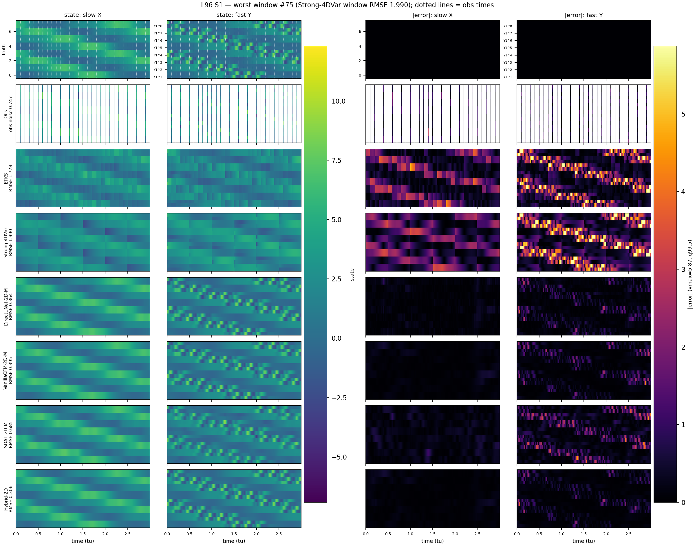

# P1 L96 benchmark — DA baselines, deterministic, flow-matching and SDA (2D backbone)

Two-scale L96, `obs_j=2` (24D observed space: 8 slow + 16 fast), the 200 shared P1 test windows. **S0** = true parameters; **S1** = ±20% parameter perturbation with ±10% bias (the DA forward model uses the biased `*_da` values), so `S1/S0` is a robustness-to-model-error ratio: 1.0 means untouched. Every RMSE cell is the **per-window RMSE on the 24 observed channels, mean ± sd across the 200 windows**, in **physical units** (seeds pooled per window).

**2D backbone (2026-10-21).** Every learned row is the 2D (time x sector) circular U-Net of `models/monai_unet_l96_2d.py`: the observed state on a (T, 8) grid, sector k carrying X_k and its observed Y_k,j as channels, circular padding over the sectors (never downsampled), zero padding and 2x resampling in time, mid-level attention along time, the widths of the 1D tiers. The 1D U-Net rows this report used to show remain in `l96_benchmark_extended.md`. **Seeds:** the benchmark plans 3 seeds per row; `seeds` = finished / planned, rows with fewer than 3 carry a note, and rows whose 2D checkpoint is not trained yet (PredictStateCFM, SDA2, SDA3-fix and the DirectUNet -> SDA3-fix hybrid) render as pending.

**Evaluation framework (2026-10-02).** Sections 1-4, the cross-family reading, the per-window and pooled summaries and the reconstruction examples use the **benchmark-default** framework of `l96_benchmark_extended.md` and are scored by that report's code: learned models trained on a random observing system with fresh noise every batch (`config/l96_benchmark_default.yaml`), 1200 epochs, M tier; DA at the per-method inflation of #295 plus the ETKS of #299; every scheme on **both** the regular 30-obs test set and the canonical random observing system. Flagged rows (italic, with a note) are sensitivity or interim rows and stay out of the bests. **Annex A** compares the 2D S / M / L tiers (seed 1).

## Protocol

| family | protocol | columns |
|---|---|---|
| DA baselines | per-window assimilation (dws=500, DA fast weights), 30 members; ETKS = the ETKF plus a full-window smoother | RMSE; analysis-ensemble CRPS and spread for ETKF/EnKF/ETKS; none for Strong-4DVar |
| Deterministic | DirectUNet-2D, single forward pass | RMSE; `var ratio` = predicted / true temporal variance (1.0 = no smoothing) |
| Flow matching | `ens30_no20` (30 members, 20 early-fine Euler steps) | ensemble-mean RMSE; proper ensemble CRPS; `spread/RMSE` = window-mean spread / window-mean RMSE (biased low against the pooled spread/skill, `docs/results/l96_p1_fm_score.md`) |
| SDA | guided `ens30`, 10 steps, `gw=25`, `r_var=0.5`; the params-conditioned priors (SDA2, SDA3-fix) get the biased DA params at S1 | as above |
| Hybrid | SDA guided sampling started at tau0 0.1 from the DirectUNet-2D-M estimate, gw 1 (validation-selected for this mean; the 1D hybrid used gw 2) | as above |
| Test sets | regular: the P1 cache, 30 regular obs times, all 24 channels; random: `l96_testset_rlayout_n10-100_k4-16_w200_d1.pt`, 10-100 obs at stratified times, 4-16 observed fast channels per window, the exact obs the DA baselines assimilated | every learned result is checked against its test set window for window before rendering |

A single draw from a generative model is a strictly worse estimator than its ensemble mean, so the two never share a column.

## 1. DA baselines

| scheme | params | seeds | regular S0 | regular S1 | random S0 | random S1 | S1/S0 (regular) | CRPS regular S0 (S1) | CRPS random S0 (S1) | spread/RMSE regular / random (S0) | note |
|---|---|---|---|---|---|---|---|---|---|---|---|
| ETKF | λ 1.15 / 2.5 | — | 0.610 ± 0.148 | 1.409 ± 0.230 | 0.679 ± 0.243 | 1.407 ± 0.308 | 2.31 | 0.270 (0.758) | 0.306 (0.786) | 0.61 / 0.72 |  |
| EnKF | λ 1.2 / 3.0 | — | 0.641 ± 0.143 | 1.416 ± 0.229 | 0.706 ± 0.236 | 1.484 ± 0.370 | 2.21 | 0.287 (0.763) | 0.320 (0.837) | 0.65 / 0.76 |  |
| ETKS | λ 1.15 / 2.5 | — | **0.497 ± 0.164** | 1.338 ± 0.224 | **0.572 ± 0.258** | **1.347 ± 0.298** | 2.69 | 0.238 (0.771) | 0.269 (0.744) | 0.41 / 0.54 |  |
| Strong-4DVar | — | — | 0.703 ± 0.199 | 1.436 ± 0.232 | 0.742 ± 0.310 | 1.444 ± 0.246 | 2.04 | — (—) | — (—) | — / — |  |
| Weak-4DVar | q 0.03 / 0.3, 40 it | — | 0.695 ± 0.191 | **1.064 ± 0.182** | — | — | 1.53 | — (—) | — | — / — |  |
| *ETKS, 100 members* | λ 1.05 / 2.5 | — | 0.393 ± 0.106 | 1.338 ± 0.221 | 0.463 ± 0.237 | 1.335 ± 0.297 | 3.41 | 0.179 (0.769) | 0.206 (0.733) | 0.46 / 0.51 | ensemble size: 100 members (the benchmark and the learned ensembles use 30), inflation re-selected on the validation windows at N=100 |

## 2. Deterministic point estimators

| scheme | params | seeds | regular S0 | regular S1 | random S0 | random S1 | S1/S0 (regular) | CRPS regular S0 (S1) | CRPS random S0 (S1) | var ratio regular / random (S0) | note |
|---|---|---|---|---|---|---|---|---|---|---|---|
| DirectUNet-2D-M | 5.63 M, 1200 ep | 3/3 | **0.248 ± 0.045** | **0.245 ± 0.043** | **0.363 ± 0.318** | **0.345 ± 0.267** | 0.99 | — | — | 0.995 / 0.942 |  |

### The flows' tau=0 mean components, as deterministic estimators

_pending for the 2D flows: `mu(x0, tau=0, y)` has only been measured on the 1D flows (`reports/l96/eval_mean_component.py`, git history of this report)._

## 3. Flow matching

| scheme | params | seeds | regular S0 | regular S1 | random S0 | random S1 | S1/S0 (regular) | CRPS regular S0 (S1) | CRPS random S0 (S1) | spread/RMSE regular / random (S0) | note |
|---|---|---|---|---|---|---|---|---|---|---|---|
| PredictStateCFM-2D-M | 1200 ep | 0/3 | pending | pending | pending | pending | | | | | not trained yet |
| VanillaCFM-2D-M | 5.64 M, 1200 ep | 1/3 | **0.220 ± 0.051** | **0.217 ± 0.053** | **0.305 ± 0.237** | **0.300 ± 0.212** | 0.99 | 0.093 (0.092) | 0.129 (0.127) | 0.69 / 0.70 | seed 1 only: seeds 2-3 not trained yet |

## 4. SDA (score-based prior + guidance)

| scheme | params | seeds | regular S0 | regular S1 | random S0 | random S1 | S1/S0 (regular) | CRPS regular S0 (S1) | CRPS random S0 (S1) | spread/RMSE regular / random (S0) | note |
|---|---|---|---|---|---|---|---|---|---|---|---|
| SDA1-2D-M | 5.63 M, gw 25 | 1/3 | **0.413 ± 0.095** | **0.410 ± 0.093** | **0.517 ± 0.230** | **0.541 ± 0.243** | 0.99 | 0.196 (0.195) | 0.248 (0.264) | 0.52 / 0.47 | seed 1 only: seeds 2-3 not trained yet |
| SDA2-2D-M | gw 25 | 0/3 | pending | pending | pending | pending | | | | | not trained yet |
| SDA3-fix-2D-M | gw 25 | 0/3 | pending | pending | pending | pending | | | | | not trained yet |
| Hybrid DirectUNet-2D-M -> SDA3-fix-2D-M | tau0 0.1, gw 1 | 0/3 | pending | pending | pending | pending | | | | | two families: SDA guided sampling started from the DirectUNet-2D-M estimate (reference); not trained yet |
| *Hybrid DirectUNet-2D-M -> SDA1-2D-M* | 2 x 5.63 M, tau0 0.1, gw 1 | 1/3 | 0.197 ± 0.043 | 0.192 ± 0.042 | 0.267 ± 0.200 | 0.261 ± 0.182 | 0.98 | 0.087 (0.085) | 0.125 (0.121) | 0.54 / 0.44 | two families: SDA guided sampling started from the DirectUNet-2D-M estimate (reference); SDA1 prior until SDA3-fix-2D-M is trained; seed 1 only: seeds 2-3 not trained yet |
| *Hybrid DirectUNet-2D-M -> SDA3-fix-M (1D prior)* | 5.63 M + 5.89 M, tau0 0.1, gw 1 | 3/3 | 0.247 ± 0.049 | 0.242 ± 0.048 | 0.320 ± 0.208 | 0.311 ± 0.182 | 0.98 | 0.113 (0.111) | 0.151 (0.144) | 0.62 / 0.51 | interim: the 1D SDA3-fix-M prior started from the 2D DirectUNet, until SDA3-fix-2D-M is trained |

Rows and their sources: `l96_benchmark_extended.md` (section 1, groups `2D ...`, and its input bundle).

## Cross-family reading

Every learned row is the 2D (time x sector) circular backbone. Best regular / random S0 of each family: deterministic DirectUNet-2D-M 0.248 / 0.363 (3 seeds), flow matching VanillaCFM-2D-M 0.220 / 0.305 (1 seed), SDA SDA1-2D-M 0.413 / 0.517 (1 seed), DA ETKS 0.497 / 0.572.

- **Flow matching vs the deterministic U-Net**: the best 2D flow is 11.2% ahead of DirectUNet-2D-M on the regular set (0.220 vs 0.248; the flow is 1 seed), and on the random set 0.305 vs 0.363. It also brings an ensemble (CRPS 0.093, per-window spread/RMSE 0.69). With the 1D backbone the two were level (0.351 / 0.340, `l96_benchmark_extended.md`).
- **SDA alone trails** (SDA1-2D-M 0.413 regular S0, 88% behind the best amortised scheme), but the guided sampler refines a DirectUNet-2D estimate: Hybrid DirectUNet-2D-M -> SDA1-2D-M 0.197 / 0.267 (1 seed); Hybrid DirectUNet-2D-M -> SDA3-fix-M (1D prior) 0.247 / 0.320 (3 seeds) (regular / random S0). SDA2-2D and SDA3-fix-2D, and hence the paper's DirectUNet -> SDA3-fix hybrid, are not trained yet.
- **The S1/S0 ratio separates the two worlds.** Learned schemes stay flat under model error (0.99-0.99); the DA baselines degrade 1.5-2.7x. At S0 the best DA (ETKS 0.497) is 126% behind the best learned row with 30 members, 79% with 100 members (flagged row); at S1 its RMSE is 6.2x the best learned row's.
- Tiers (S / M / L) of the 2D families: annex A. PredictStateCFM, SDA2 and SDA3-fix have no 2D checkpoint yet; their rows stay pending.

## Per-window RMSE / EV / CRPS summary (2D backbone)

Generated from the `benchmark_extended` inputs by `reports/l96/per_window_summary.py` (`backbone="2d"`): the DA rows of the 1D summary, every U-Net row replaced by its 2D (time x sector) circular-backbone counterpart at the benchmark recipe (1200 epochs, M tier). `seeds` = finished seeds of the 3 planned; a row with `—` everywhere is not trained yet. The hybrids use tau0 0.1, gw 1 (validated for the DirectUNet-2D mean); the *interim* row starts the 1D SDA3-fix prior from the 2D DirectUNet and is the only 3-seed hybrid until SDA3-fix-2D is trained.

Per window, on the 24 observed channels of the 200 P1 test windows: **RMSE** is the per-channel RMSE over time; **EV** is per-channel 1 - SSE/SST over time, with SST about the window's own mean, so it is lower than the pooled EV of the benchmark JSONs; **CRPS** is taken on the analysis ensemble (DA) or the members (flows, SDA). Each is averaged over channels. Seeds are averaged per window; cells are mean ± sd over the 200 windows. Per column, the best value is in **bold** and the second best in *italics*. Deterministic schemes have no CRPS. The random-layout Strong-4DVar trajectories were not kept, so that cell has no EV.

**RMSE** (lower is better)

| family | scheme | seeds | regular S0 | regular S1 | random S0 | random S1 |
|---|---|---|---|---|---|---|
| DA | ETKF (inflation 1.15 / 2.5) | — | 0.610 ± 0.148 | 1.409 ± 0.230 | 0.679 ± 0.243 | 1.407 ± 0.308 |
| DA | EnKF (inflation 1.2 / 3.0) | — | 0.641 ± 0.143 | 1.416 ± 0.229 | 0.706 ± 0.236 | 1.484 ± 0.370 |
| DA | ETKS (inflation 1.15 / 2.5) | — | 0.497 ± 0.164 | 1.338 ± 0.224 | 0.572 ± 0.258 | 1.347 ± 0.298 |
| DA | Strong-4DVar | — | 0.703 ± 0.199 | 1.436 ± 0.232 | 0.742 ± 0.310 | 1.444 ± 0.246 |
| SDA 2D (gw 25, 1200 ep) | SDA1-2D-M | 1 | 0.413 ± 0.095 | 0.410 ± 0.093 | 0.517 ± 0.230 | 0.541 ± 0.243 |
| SDA 2D (gw 25, 1200 ep) | SDA2-2D-M | — | — | — | — | — |
| SDA 2D (gw 25, 1200 ep) | SDA3-fix-2D-M | — | — | — | — | — |
| DirectUNet 2D (1200 ep) | DirectUNet-2D-M | 3 | 0.248 ± 0.045 | 0.245 ± 0.043 | 0.363 ± 0.318 | 0.345 ± 0.267 |
| CFM 2D (1200 ep) | PredictStateCFM-2D-M | — | — | — | — | — |
| CFM 2D (1200 ep) | VanillaCFM-2D-M | 1 | *0.220* ± 0.051 | *0.217* ± 0.053 | *0.305* ± 0.237 | *0.300* ± 0.212 |
| Hybrid 2D (tau0 0.1, gw 1) | DirectUNet-2D-M -> SDA3-fix-2D-M | — | — | — | — | — |
| Hybrid 2D (tau0 0.1, gw 1) | DirectUNet-2D-M -> SDA1-2D-M | 1 | **0.197** ± 0.043 | **0.192** ± 0.042 | **0.267** ± 0.200 | **0.261** ± 0.182 |
| *interim* | *DirectUNet-2D-M -> SDA3-fix-M (1D prior)* | 3 | 0.247 ± 0.049 | 0.242 ± 0.048 | 0.320 ± 0.208 | 0.311 ± 0.182 |

**EV** (higher is better)

| family | scheme | seeds | regular S0 | regular S1 | random S0 | random S1 |
|---|---|---|---|---|---|---|
| DA | ETKF (inflation 1.15 / 2.5) | — | 0.821 ± 0.067 | 0.265 ± 0.076 | 0.766 ± 0.143 | 0.152 ± 0.303 |
| DA | EnKF (inflation 1.2 / 3.0) | — | 0.802 ± 0.070 | 0.258 ± 0.076 | 0.754 ± 0.135 | 0.028 ± 0.564 |
| DA | ETKS (inflation 1.15 / 2.5) | — | 0.872 ± 0.077 | 0.350 ± 0.084 | 0.818 ± 0.143 | 0.222 ± 0.259 |
| DA | Strong-4DVar | — | 0.745 ± 0.124 | 0.229 ± 0.072 | — | — |
| SDA 2D (gw 25, 1200 ep) | SDA1-2D-M | 1 | 0.927 ± 0.017 | 0.927 ± 0.015 | 0.864 ± 0.110 | 0.850 ± 0.116 |
| SDA 2D (gw 25, 1200 ep) | SDA2-2D-M | — | — | — | — | — |
| SDA 2D (gw 25, 1200 ep) | SDA3-fix-2D-M | — | — | — | — | — |
| DirectUNet 2D (1200 ep) | DirectUNet-2D-M | 3 | 0.972 ± 0.007 | 0.972 ± 0.007 | 0.916 ± 0.133 | 0.924 ± 0.115 |
| CFM 2D (1200 ep) | PredictStateCFM-2D-M | — | — | — | — | — |
| CFM 2D (1200 ep) | VanillaCFM-2D-M | 1 | *0.977* ± 0.009 | *0.977* ± 0.009 | 0.937 ± 0.092 | 0.939 ± 0.087 |
| Hybrid 2D (tau0 0.1, gw 1) | DirectUNet-2D-M -> SDA3-fix-2D-M | — | — | — | — | — |
| Hybrid 2D (tau0 0.1, gw 1) | DirectUNet-2D-M -> SDA1-2D-M | 1 | **0.981** ± 0.007 | **0.982** ± 0.007 | **0.950** ± 0.075 | **0.952** ± 0.073 |
| *interim* | *DirectUNet-2D-M -> SDA3-fix-M (1D prior)* | 3 | 0.972 ± 0.008 | 0.973 ± 0.008 | *0.938* ± 0.082 | *0.942* ± 0.076 |

**CRPS** (lower is better)

| family | scheme | seeds | regular S0 | regular S1 | random S0 | random S1 |
|---|---|---|---|---|---|---|
| DA | ETKF (inflation 1.15 / 2.5) | — | 0.270 ± 0.071 | 0.758 ± 0.132 | 0.306 ± 0.111 | 0.786 ± 0.173 |
| DA | EnKF (inflation 1.2 / 3.0) | — | 0.287 ± 0.069 | 0.763 ± 0.124 | 0.320 ± 0.109 | 0.837 ± 0.186 |
| DA | ETKS (inflation 1.15 / 2.5) | — | 0.238 ± 0.085 | 0.771 ± 0.142 | 0.269 ± 0.122 | 0.744 ± 0.179 |
| DA | Strong-4DVar | — | — | — | — | — |
| SDA 2D (gw 25, 1200 ep) | SDA1-2D-M | 1 | 0.196 ± 0.045 | 0.195 ± 0.042 | 0.248 ± 0.109 | 0.264 ± 0.119 |
| SDA 2D (gw 25, 1200 ep) | SDA2-2D-M | — | — | — | — | — |
| SDA 2D (gw 25, 1200 ep) | SDA3-fix-2D-M | — | — | — | — | — |
| DirectUNet 2D (1200 ep) | DirectUNet-2D-M | 3 | — | — | — | — |
| CFM 2D (1200 ep) | PredictStateCFM-2D-M | — | — | — | — | — |
| CFM 2D (1200 ep) | VanillaCFM-2D-M | 1 | *0.093* ± 0.020 | *0.092* ± 0.021 | *0.129* ± 0.102 | *0.127* ± 0.092 |
| Hybrid 2D (tau0 0.1, gw 1) | DirectUNet-2D-M -> SDA3-fix-2D-M | — | — | — | — | — |
| Hybrid 2D (tau0 0.1, gw 1) | DirectUNet-2D-M -> SDA1-2D-M | 1 | **0.087** ± 0.017 | **0.085** ± 0.018 | **0.125** ± 0.108 | **0.121** ± 0.097 |
| *interim* | *DirectUNet-2D-M -> SDA3-fix-M (1D prior)* | 3 | 0.113 ± 0.022 | 0.111 ± 0.022 | 0.151 ± 0.106 | 0.144 ± 0.089 |

## Pooled skill scores (paper tables `tab:s0` / `tab:s1`, regular test set)

Per channel, pooled over the 200 windows and all time steps, then averaged over the 24 observed channels: **EV** = 1 − MSE / Var(truth); **CRPSS** = 1 − CRPS / CRPS_clim against the climatological (test-truth marginal) CRPS; point estimates show the MAE skill 1 − MAE / CRPS_clim instead (in brackets). Learned rows: 2D backbone, mean over the finished seeds (`seeds`); `pending` = not trained yet. Code: `reports/l96/p1_skill.py`. Per column, best **bold**, second *italic*.

| scheme | seeds | EV S0 | CRPSS S0 | EV S1 | CRPSS S1 |
|---|---|---|---|---|---|
| ETKF | — | 0.815 | 0.710 | 0.272 | 0.201 |
| EnKF | — | 0.801 | 0.693 | 0.266 | 0.196 |
| ETKS | — | 0.866 | 0.744 | 0.358 | 0.191 |
| Strong-4DVar | — | 0.741 | (0.523) | 0.239 | (-0.042) |
| Weak-4DVar | — | 0.757 | (0.520) | 0.561 | (0.225) |
| D-Unet (DirectUNet-2D-M) | 3/3 | 0.972 | (0.840) | 0.973 | (0.841) |
| CFM (VanillaCFM-2D-M) | 1/3 | *0.977* | *0.901* | *0.977* | *0.901* |
| PredictStateCFM-2D-M | 0/3 | pending | pending | pending | pending |
| SDA1-2D-M | 1/3 | 0.923 | 0.790 | 0.924 | 0.790 |
| SDA2-2D-M | 0/3 | pending | pending | pending | pending |
| SDA3-fix-2D-M | 0/3 | pending | pending | pending | pending |
| D-Unet+SDA (DirectUNet-2D-M -> SDA3-fix-2D-M) | 0/3 | pending | pending | pending | pending |
| DirectUNet-2D-M -> SDA1-2D-M | 1/3 | **0.981** | **0.908** | **0.982** | **0.909** |
| DirectUNet-2D-M -> SDA3-fix-M (1D prior, interim) | 3/3 | 0.972 | 0.879 | 0.973 | 0.881 |

## Distributional score FMS_τ

_pending for the 2D rows: the FMS_τ probes (`reports/l96/probe_fm_score*.py`) need the 2D ensembles' per-element mean and variance, which the benchmark runs did not store; they will be re-run with the 2D training of step 2. The 1D section is in this report's git history and `docs/results/l96_p1_fm_score.md`._

## Caveats

- DA baselines receive the same per-window parameters as truth generation (S0) or their biased `*_da` counterparts (S1); the learned schemes see observations only. This is what makes the comparison apples-to-apples, and also why their S1 behaviour differs so much.
- DA CRPS is the per-window analysis-ensemble CRPS stored by the runs (30 members), comparable to the generative families' ensemble CRPS.
- SDA is the only learned family with a tuned inference hyper-parameter (`gw`, 25 as for 1D, not re-tuned for 2D); the hybrid tunes its start time and guidance on the validation windows (tau0 0.1, gw 1 for the DirectUNet-2D mean).
- Single-seed 2D rows: VanillaCFM-2D-M, SDA1-2D-M, the DirectUNet-2D-M -> SDA1-2D-M hybrid and the annex tiers. Their seed spread is unknown; the 1D seed sd was 0.002-0.005 at regular S0.

## Reconstruction examples

Best / median / worst windows, ranked by Strong-4DVar per-window RMSE (the same convention as the consolidated benchmark, so window choices are comparable across reports). Rows are Truth / Obs / one scheme per family under the benchmark framework (seed 1 of each 1200-epoch model; the hybrid as reference); columns are the state and |error| maps for the slow X (8D) and fast Y (16D) blocks. Generative rows are plotted as their **ensemble mean** — the estimator their RMSE column scores.

| case | rank | window | 4DVar win-RMSE | ETKS | Strong-4DVar | DirectUNet-2D-M | VanillaCFM-2D-M | SDA1-2D-M | Hybrid-2D |
|---|---|---|---|---|---|---|---|---|---|
| S0 | best | 146 | 0.352 | 0.437 | 0.352 | 0.199 | 0.181 | 0.309 | 0.183 |
| S0 | median | 2 | 0.773 | 1.137 | 0.773 | 0.320 | 0.332 | 0.652 | 0.251 |
| S0 | worst | 56 | 1.497 | 0.724 | 1.497 | 0.415 | 0.368 | 0.502 | 0.378 |
| S1 | best | 35 | 0.975 | 0.882 | 0.975 | 0.197 | 0.151 | 0.254 | 0.145 |
| S1 | median | 10 | 1.474 | 1.341 | 1.474 | 0.233 | 0.191 | 0.377 | 0.162 |
| S1 | worst | 75 | 1.990 | 1.778 | 1.990 | 0.364 | 0.395 | 0.685 | 0.306 |

**Observing system.** `obs_mask` is a single 1-D mask over time shared by every dimension, so slow and fast are observed at exactly the same instants: **30 observed timesteps per window** (`obs_interval=100` over T=3000). What differs between them is spatial, not temporal — all 8 slow X are observed, but only 16 of the 32 fast Y (`obs_j=2` of `J=4`), which is why the fast block is 16 rows.

Each observation is drawn as a 11-column band rather than a single 1/3000 column, which would be ~0.15 px and mostly vanish under rasterization. That is display-only and inflates the Obs row's |error| column (labelled 'obs noise') by ~1.7%; the undistorted values are S0/best 0.7003, S0/median 0.7113, S0/worst 0.6836, S1/best 0.7013, S1/median 0.7116, S1/worst 0.7327.

## Annex A. 2D tiers (S / M / L, seed 1)

S / M / L widths of the 2D backbone (the widths of the 1D S / M / L tiers), benchmark recipe, seed 1 of each (the M row is seed 1 of the 3-seed row above, so it can differ from the section tables). Per-window RMSE, window mean; CRPS for the ensembles. The 1D P1-protocol annex (tiers, CFM parameterization, SDA conditioning under a fixed observing system) is superseded and no longer rendered; its 1D rows remain in git history and the 1D benchmark rows in `l96_benchmark_extended.md`.

| family | tier | params | regular S0 | regular S1 | random S0 | random S1 | CRPS regular S0 | CRPS random S0 |
|---|---|---|---|---|---|---|---|---|
| DirectUNet-2D | S | 2.03 M | 0.262 | 0.258 | 0.378 | 0.362 | — | — |
| DirectUNet-2D | M | 5.63 M | 0.247 | 0.243 | 0.362 | 0.345 | — | — |
| DirectUNet-2D | **L** | 22.5 M | 0.239 | 0.238 | 0.355 | 0.337 | — | — |
| VanillaCFM-2D | S | 2.03 M | 0.241 | 0.238 | 0.341 | 0.336 | 0.103 | 0.146 |
| VanillaCFM-2D | M | 5.64 M | 0.220 | 0.217 | 0.305 | 0.300 | 0.093 | 0.129 |
| VanillaCFM-2D | **L** | 22.5 M | 0.195 | 0.190 | 0.268 | 0.262 | 0.082 | 0.112 |
| SDA1-2D (gw 25) | **S** | 2.03 M | 0.401 | 0.397 | 0.511 | 0.534 | 0.188 | 0.238 |
| SDA1-2D (gw 25) | M | 5.63 M | 0.413 | 0.410 | 0.517 | 0.541 | 0.196 | 0.248 |
| SDA1-2D (gw 25) | L | 22.5 M | 0.443 | 0.442 | 0.539 | 0.561 | 0.209 | 0.255 |
| Hybrid DirectUNet-2D-M -> SDA1-2D (gw 1) | M | 2 x 5.63 M | 0.197 | 0.192 | 0.267 | 0.261 | 0.087 | 0.125 |
| Hybrid DirectUNet-2D-M -> SDA1-2D (gw 1) | **L** | 5.63 M + 22.5 M | 0.191 | 0.186 | 0.262 | 0.255 | 0.083 | 0.124 |

