# QG gyrostat case study: DA baselines and neural schemes (S0 + realistic S1)

Two-layer QG ocean (64×64, 1000 km, dt 2 h) forced by the wind-stress curl of a gyrostat atmosphere (`l63ring4`, 12 Fourier modes |k| ≤ 2) plus relative-wind eddy drag. Test sets: 100 windows of 30 days of the **forced** dataset `qg_specwind_gyrostat_v1` and of the paired two-way **coupled** dataset `qg_coupled_gyrostat_v1` (κ_fb = 1). Design: `docs/plans/analysis/qg_specwind_da_s0.md`, `docs/plans/analysis/qg_specwind_da_s1.md`; written findings: `docs/results/qg_specwind_da_s0_s1_test.md`. Neural schemes (DirectUNet, CFM, SDA prior and SDA hybrids) on the forced test set, and their observation-configuration stress test: sections 9–10.

**Reference case (S0):** upper-layer ψ₁ observed on 3 random meridional columns per day (4.7% of the grid), each once per day, 5% noise; initial state = truth lagged about 5 days with a bred 80-member ensemble; the DA model is exact and gets the true wind.

**Filters:** ETKF with the exact localized EnSRF update (radius 8, ridge 0.1; since 2026-09-28, `docs/results/qg_specwind_etkf_loc_update.md` — earlier renders used a localized update with unnormalized covariances and a full-gain anomaly update, radius 8 / ridge 1); EnKF radius 6; both with cross-layer localization weight 1 and N = 80, inflation 1.0.

**4D-Var:** deterministic, from the lagged-truth background; climatological B from a per-wavenumber-shell 2×2 inter-layer spectral covariance (`spectral_b_sqrt`), whitened control, L-BFGS (60 iterations), cycled over 10-day sub-windows; a sub-window whose optimization is non-finite or raises the cost falls back to the background forecast. Strong constraint in S0; in S1 also the weak constraint (additive model-error control, scale 0.1 of B), tuned on val (`docs/results/qg_specwind_4dvar.md`). Its CRPS column is the MAE of q (a deterministic CRPS) and is not ranked against the ensembles.

**S1 (realistic base, model error):** wind amplitude +15%, random wind error 25% of each mode's RMS, wind position error 50 km; rd −10%; bottom drag −50%; altimetry error 15% white + 15% correlated per pass (the filter's R = total variance, white); DA model on a 32×32 grid (rd unresolved). Calibrated on val: `docs/results/qg_specwind_da_s1_calibration.md`.

**Metrics:** EV = 1 − MSE / Var(truth) per window over its 30 days, averaged over windows; ψ inverted with each window's own parameters; score = mean of the four EVs; 95% intervals by bootstrap over windows. Generated by `reports/qg/generate_qg_specwind_da_report.py` (figures: `reports/qg/generate_qg_specwind_da_figs.py`).

## Benchmark overview (score, 3 columns per day, N = 80)

Mean of the four EVs over 100 test windows; best per column **bolded**, second-best *italicized*. S1-tuned = ensembles with R × 6, 4D-Var with the weak constraint (strong in the other two columns). Per-field tables and intervals in sections 2–3. The neural schemes and the DA reference rows side by side, across observation configurations: section 10.

| method | S0 forced | S0 coupled | S1, S0-tuned forced | S1, S0-tuned coupled | S1-tuned forced | S1-tuned coupled |
|---|---|---|---|---|---|---|
| ETKF | 0.774 | 0.779 | 0.579 | 0.586 | 0.633 | *0.642* |
| EnKF | 0.761 | 0.768 | *0.596* | *0.604* | *0.634* | *0.642* |
| EnKS | *0.812* | *0.819* | **0.612** | **0.620** | **0.665** | **0.673** |
| 4D-Var (strong / weak) | **0.840** | **0.847** | 0.516 | 0.527 | 0.612 | 0.619 |

## 1. Case study

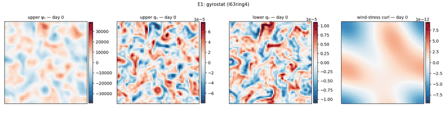

The gyrostat drives domain-scale wind-stress-curl patterns with regime changes; the ocean responds with a forced large-scale circulation on top of its own baroclinic eddies. Windows differ in ocean parameters (rd, U1, drag), wind level (21% of the test windows are calm, level 0) and gyrostat time unit.

## 2. DA baselines — S0 (perfect model, true wind), 3 columns per day

**Forced dataset**

| method | ψ₁ | ψ₂ | q₁ | q₂ | score | score 95% CI | CRPS q (×10⁻⁶, lower is better) | spread/RMSE q₁ |
|---|---|---|---|---|---|---|---|---|
| _free forecast_ | 0.759 | 0.848 | -0.057 | 0.043 | 0.398 |  |  |  |
| ETKF (radius 8) | 0.937 | 0.933 | 0.647 | 0.578 | 0.774 | [0.762, 0.786] | *5.875* | 0.72 |
| EnKF (radius 6) | 0.929 | 0.918 | 0.635 | 0.562 | 0.761 | [0.749, 0.773] | 6.016 | — |
| EnKS (ETKF smoother) (radius 8, no lag cutoff, time taper 8 d) | *0.966* | *0.959* | *0.727* | *0.596* | *0.812* | [0.801, 0.823] | **5.315** | 0.67 |
| strong 4D-Var (spectral B, 10-day sub-windows; 3 sub-window fallbacks) | **0.978** | **0.983** | **0.752** | **0.648** | **0.840** | [0.826, 0.854] | (6.871, MAE) | — |

**Coupled dataset**

| method | ψ₁ | ψ₂ | q₁ | q₂ | score | score 95% CI | CRPS q (×10⁻⁶, lower is better) | spread/RMSE q₁ |
|---|---|---|---|---|---|---|---|---|
| _free forecast_ | 0.745 | 0.838 | -0.044 | 0.068 | 0.402 |  |  |  |
| ETKF (radius 8) | 0.936 | 0.933 | 0.651 | 0.595 | 0.779 | [0.767, 0.791] | *5.735* | 0.73 |
| EnKF (radius 6) | 0.929 | 0.919 | 0.643 | 0.580 | 0.768 | [0.755, 0.780] | 5.847 | — |
| EnKS (ETKF smoother) (radius 8, no lag cutoff, time taper 8 d) | *0.967* | *0.959* | *0.734* | *0.615* | *0.819* | [0.808, 0.830] | **5.155** | 0.67 |
| strong 4D-Var (spectral B, 10-day sub-windows; 2 sub-window fallbacks) | **0.978** | **0.984** | **0.761** | **0.665** | **0.847** | [0.833, 0.860] | (6.608, MAE) | — |

(Best per column **bolded**, second-best *italicized*, among the DA methods; the free forecast is a reference row; CRPS is ranked lowest-best; spread/RMSE q₁ (median over windows) is not ranked: 1 is calibrated. The EnKS is the localized ensemble Kalman smoother on the ETKF: it also uses observations after each time, so it is a reanalysis-type estimate, not a filter.)

## 3. DA baselines — S1 (realistic base), 3 columns per day

**Forced dataset**

| method | ψ₁ | ψ₂ | q₁ | q₂ | score | score 95% CI | CRPS q (×10⁻⁶, lower is better) | spread/RMSE q₁ |
|---|---|---|---|---|---|---|---|---|
| _free forecast_ | 0.127 | -0.934 | -0.254 | -0.363 | -0.356 |  |  |  |
| ETKF (radius 8) | 0.848 | *0.757* | 0.433 | 0.277 | 0.579 | [0.560, 0.598] | 7.880 | 0.70 |
| EnKF (radius 6) | 0.847 | **0.762** | *0.450* | **0.326** | *0.596* | [0.578, 0.615] | *7.711* | — |
| EnKS (ETKF smoother) (radius 8, no lag cutoff, time taper 8 d) | **0.881** | 0.738 | **0.522** | *0.309* | **0.612** | [0.590, 0.633] | **7.437** | 0.63 |
| strong 4D-Var (spectral B, 10-day sub-windows) | *0.852* | 0.706 | 0.368 | 0.139 | 0.516 | [0.481, 0.549] | (11.481, MAE) | — |

**Coupled dataset**

| method | ψ₁ | ψ₂ | q₁ | q₂ | score | score 95% CI | CRPS q (×10⁻⁶, lower is better) | spread/RMSE q₁ |
|---|---|---|---|---|---|---|---|---|
| _free forecast_ | 0.113 | -0.914 | -0.260 | -0.352 | -0.353 |  |  |  |
| ETKF (radius 8) | 0.848 | *0.766* | 0.437 | 0.295 | 0.586 | [0.568, 0.605] | 7.733 | 0.70 |
| EnKF (radius 6) | 0.847 | **0.771** | *0.454* | **0.343** | *0.604* | [0.586, 0.622] | *7.575* | — |
| EnKS (ETKF smoother) (radius 8, no lag cutoff, time taper 8 d) | **0.880** | 0.741 | **0.530** | *0.330* | **0.620** | [0.598, 0.641] | **7.270** | 0.63 |
| strong 4D-Var (spectral B, 10-day sub-windows) | *0.851* | 0.714 | 0.374 | 0.170 | 0.527 | [0.492, 0.560] | (11.207, MAE) | — |

(Best per column **bolded**, second-best *italicized*, among the DA methods; the free forecast is a reference row; CRPS is ranked lowest-best; spread/RMSE q₁ (median over windows) is not ranked: 1 is calibrated. The EnKS is the localized ensemble Kalman smoother on the ETKF: it also uses observations after each time, so it is a reanalysis-type estimate, not a filter.)

### S1-tuned filters (observation-error variance × 6), 3 columns per day

Same S1, with the filters' R scaled on val to absorb the model error (`docs/results/qg_specwind_s1_tuning.md`); inflation > 1 diverges here. The rows above use the S0-tuned filters. The 4D-Var row is the weak constraint at R × 1 (inflating R hurts 4D-Var; `docs/results/qg_specwind_4dvar.md`). Relaxation inflation (RTPS/RTPP) was tested on val as an alternative: it is stable and calibrates the spread, but trails R × 6 by about 0.03 and adds at most +0.004 on top of it, so the S1-tuned rows keep R × 6 without relaxation (`docs/results/qg_specwind_relax_inflation.md`).

**Forced dataset**

| method | ψ₁ | ψ₂ | q₁ | q₂ | score | score 95% CI | CRPS q (×10⁻⁶, lower is better) | spread/RMSE q₁ |
|---|---|---|---|---|---|---|---|---|
| _free forecast_ | 0.127 | -0.934 | -0.254 | -0.363 | -0.356 |  |  |  |
| ETKF (radius 8) | 0.865 | 0.791 | 0.473 | 0.402 | 0.633 | [0.615, 0.650] | *7.364* | 0.87 |
| EnKF (radius 6) | 0.861 | **0.798** | 0.468 | *0.409* | *0.634* | [0.617, 0.650] | 7.394 | 0.86 |
| EnKS (ETKF smoother) (radius 8, no lag cutoff, time taper 8 d) | *0.894* | 0.783 | **0.547** | **0.437** | **0.665** | [0.646, 0.683] | **6.935** | 0.84 |
| weak 4D-Var (spectral B, 10-day sub-windows, model-error scale 0.1) | **0.897** | *0.797* | *0.480* | 0.273 | 0.612 | [0.582, 0.639] | (10.417, MAE) | — |

**Coupled dataset**

| method | ψ₁ | ψ₂ | q₁ | q₂ | score | score 95% CI | CRPS q (×10⁻⁶, lower is better) | spread/RMSE q₁ |
|---|---|---|---|---|---|---|---|---|
| _free forecast_ | 0.113 | -0.914 | -0.260 | -0.352 | -0.353 |  |  |  |
| ETKF (radius 8) | 0.865 | 0.799 | 0.481 | 0.421 | *0.642* | [0.624, 0.659] | *7.204* | 0.88 |
| EnKF (radius 6) | 0.860 | **0.805** | 0.474 | *0.428* | *0.642* | [0.626, 0.658] | 7.243 | 0.86 |
| EnKS (ETKF smoother) (radius 8, no lag cutoff, time taper 8 d) | *0.893* | 0.786 | **0.556** | **0.456** | **0.673** | [0.653, 0.691] | **6.774** | 0.84 |
| weak 4D-Var (spectral B, 10-day sub-windows, model-error scale 0.1) | **0.895** | *0.800* | *0.486* | 0.294 | 0.619 | [0.588, 0.646] | (10.183, MAE) | — |

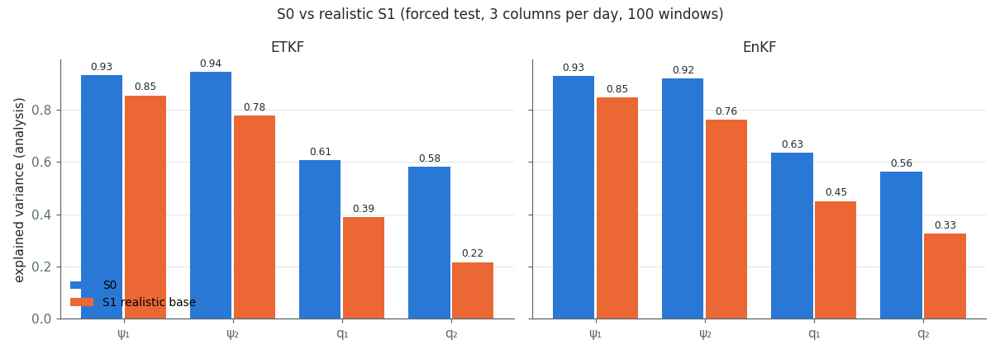

## 4. Configuration synthesis and S1 error budget

Both filters were tuned on val (`docs/results/qg_specwind_da2_val_tuning.md`): vertical localization (cross-layer weight 1, so the unobserved layer is updated) and the bred initial ensemble are the two gains; with both, a much weaker localization is optimal.

| method | tuned configuration (val, DA-2) | S0 ψ₁ / q₁ | S0 score | S1 ψ₁ / q₁ | S1 score |
|---|---|---|---|---|---|
| ETKF | N = 80, inflation 1.0, **exact localized EnSRF update, radius 8, ridge 0.1**, cross-layer weight 1, bred init | 0.937 / 0.647 | 0.774 | 0.848 / 0.433 | 0.579 |
| EnKF | N = 80, inflation 1.0, **radius 6**, cross-layer weight 1, bred init | 0.929 / 0.635 | 0.761 | 0.847 / 0.450 | 0.596 |

**S1 error budget** — Shapley share of the S0 → S1 EV loss per error group (ETKF, val, 20 windows, all 32 on/off combinations; largest share in bold):

| metric (S0 → S1) | forcing | rd | drag | obs | res | interaction |
|---|---|---|---|---|---|---|
| score (0.764 → 0.580) | 9% | 18% | 16% | **31%** | 25% | -0.000 |
| ψ₁ (0.939 → 0.862) | 11% | 13% | 10% | **40%** | 26% | +0.004 |
| ψ₂ (0.950 → 0.838) | 18% | 7% | 24% | **27%** | 25% | +0.011 |
| q₁ (0.615 → 0.389) | 6% | 19% | 4% | **46%** | 26% | -0.026 |
| q₂ (0.552 → 0.229) | 7% | 23% | 24% | 21% | **25%** | +0.009 |

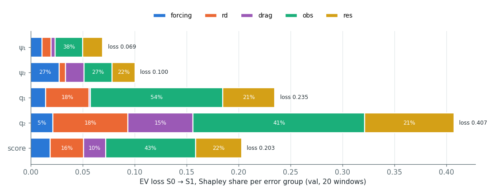

**S1-tuned error budgets** — the same attribution with each filter fixed at its S1-tuned setting (R × 6) in all 32 combinations (the S0 corner then runs R × 6 on perfect-model data: it costs nothing, ETKF 0.768 vs 0.764, EnKS 0.809 vs 0.806). Absolute Shapley score loss per group (bootstrap 95% over the 20 windows; largest in bold) and paired contrasts (`docs/results/qg_specwind_da_s1_calibration.md` §3.1d):

| filter (score S0 corner → S1) | forcing | rd | drag | obs | res | interaction | total loss |
|---|---|---|---|---|---|---|---|
| ETKF, S0-tuned (R × 1) (0.764 → 0.580) | 0.016 [0.011, 0.021] | 0.034 [0.030, 0.038] | 0.030 [0.026, 0.034] | **0.058 [0.047, 0.069]** | 0.047 [0.027, 0.068] | -0.000 | 0.184 |
| ETKF, S1-tuned (R × 6) (0.768 → 0.641) | 0.015 [0.010, 0.020] | 0.019 [0.015, 0.023] | 0.023 [0.020, 0.026] | 0.033 [0.026, 0.040] | **0.038 [0.020, 0.057]** | -0.031 | 0.127 |
| EnKS, S1-tuned (R × 6, taper 8 d) (0.809 → 0.679) | 0.025 [0.015, 0.038] | 0.016 [0.013, 0.020] | 0.023 [0.020, 0.026] | **0.034 [0.026, 0.042]** | 0.031 [0.016, 0.048] | -0.036 | 0.130 |

| paired contrast (score loss, 95% CI) | forcing | rd | drag | obs | res |
|---|---|---|---|---|---|
| S1 tuning (ETKF, R × 6 − R × 1) | -0.001 [-0.002, -0.000] | -0.015 [-0.016, -0.014] | -0.007 [-0.009, -0.005] | -0.025 [-0.031, -0.020] | -0.009 [-0.013, -0.005] |
| smoothing (EnKS − ETKF, both R × 6) | +0.010 [+0.004, +0.020] | -0.002 [-0.003, -0.001] | +0.000 [-0.001, +0.001] | +0.001 [-0.002, +0.004] | -0.007 [-0.009, -0.004] |

Share of the EV loss per field, S1-tuned EnKS:

| metric (S0 → S1) | forcing | rd | drag | obs | res | interaction |
|---|---|---|---|---|---|---|
| score (0.809 → 0.679) | 19% | 13% | 18% | **26%** | 24% | -0.036 |
| ψ₁ (0.968 → 0.910) | 32% | 9% | 6% | **32%** | 21% | -0.007 |
| ψ₂ (0.973 → 0.876) | **54%** | 6% | 17% | 2% | 21% | -0.013 |
| q₁ (0.695 → 0.520) | 7% | 11% | 5% | **57%** | 20% | -0.056 |
| q₂ (0.602 → 0.411) | 10% | 19% | **33%** | 8% | 30% | -0.068 |

### Large-ensemble reference (N = 320)

The benchmark uses N = 80. At N = 320, S0 is still not converged (val: +0.022 for the EnKS from 80 to 320), while S1 saturates by N = 160. In S0 the N = 320 rows use settings re-tuned at that size (wider localization). Use these rows to quote converged skill, for instance against learned methods (`docs/results/qg_specwind_ensemble_size.md`).

| scenario | dataset | method (N = 320 settings) | score N = 80 | score N = 320 | N 320 − 80 [95% CI] | CRPS q (×10⁻⁶) N = 80 → 320 |
|---|---|---|---|---|---|---|
| S0 | forced | ETKF (radius 12) | 0.774 | **0.794** | +0.020 [+0.018, +0.023] | 5.875 → 5.530 |
| S0 | forced | EnKS (ETKF smoother) (radius 12, taper 16 d) | 0.812 | **0.841** | +0.029 [+0.026, +0.032] | 5.315 → 4.775 |
| S0 | coupled | ETKF (radius 12) | 0.779 | **0.800** | +0.021 [+0.019, +0.024] | 5.735 → 5.371 |
| S0 | coupled | EnKS (ETKF smoother) (radius 12, taper 16 d) | 0.819 | **0.847** | +0.028 [+0.025, +0.031] | 5.155 → 4.623 |
| S1-tuned (realistic base, R × 6) | forced | ETKF (radius 8) | 0.633 | **0.641** | +0.008 [+0.007, +0.009] | 7.364 → 7.258 |
| S1-tuned (realistic base, R × 6) | forced | EnKS (ETKF smoother) (radius 8, taper 8 d) | 0.665 | **0.675** | +0.010 [+0.009, +0.012] | 6.935 → 6.811 |
| S1-tuned (realistic base, R × 6) | coupled | ETKF (radius 8) | 0.642 | **0.650** | +0.008 [+0.007, +0.009] | 7.204 → 7.099 |
| S1-tuned (realistic base, R × 6) | coupled | EnKS (ETKF smoother) (radius 8, taper 8 d) | 0.673 | **0.683** | +0.011 [+0.009, +0.012] | 6.774 → 6.643 |

## 5. Observation density (S0, forced, ETKF)

| columns per day | ψ₁ | ψ₂ | q₁ | q₂ | score |
|---|---|---|---|---|---|
| 1 (1.6% of columns) | 0.863 | 0.877 | 0.459 | 0.474 | 0.668 |
| 2 (3.1% of columns) | 0.910 | 0.912 | 0.572 | 0.541 | 0.734 |
| 3 (4.7% of columns) | 0.937 | 0.933 | 0.647 | 0.578 | 0.774 |
| 4 (6.2% of columns) | *0.950* | *0.943* | *0.695* | *0.589* | *0.794* |
| 6 (9.4% of columns) | **0.966** | **0.954** | **0.757** | **0.592** | **0.817** |

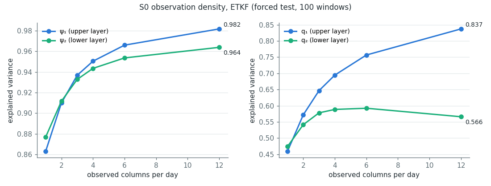

**Bridge density (4 columns per day), both datasets:**

*forced*

| method | ψ₁ | ψ₂ | q₁ | q₂ | score | score 95% CI | CRPS q (×10⁻⁶, lower is better) | spread/RMSE q₁ |
|---|---|---|---|---|---|---|---|---|
| _free forecast_ | 0.759 | 0.848 | -0.057 | 0.043 | 0.398 |  |  |  |
| ETKF (radius 8) | **0.950** | **0.943** | **0.695** | **0.589** | **0.794** | [0.783, 0.805] | **5.477** | 0.66 |
| EnKF (radius 6) | *0.945* | *0.932* | *0.688* | *0.580* | *0.786* | [0.775, 0.798] | *5.590* | — |

*coupled*

| method | ψ₁ | ψ₂ | q₁ | q₂ | score | score 95% CI | CRPS q (×10⁻⁶, lower is better) | spread/RMSE q₁ |
|---|---|---|---|---|---|---|---|---|
| _free forecast_ | 0.745 | 0.838 | -0.044 | 0.068 | 0.402 |  |  |  |
| ETKF (radius 8) | **0.951** | **0.945** | **0.702** | **0.610** | **0.802** | [0.791, 0.813] | **5.303** | 0.67 |
| EnKF (radius 6) | *0.945* | *0.933* | *0.695* | *0.598* | *0.793* | [0.782, 0.804] | *5.425* | — |

## 6. Forced vs coupled

Independent samples (paired windows share seeds but not trajectories), two-sample bootstrap.

**S0**

| method | field | forced | coupled | forced − coupled [95% CI] |
|---|---|---|---|---|
| ETKF | ψ₁ | 0.937 | 0.936 | +0.001 [-0.011, +0.013] |
| ETKF | ψ₂ | 0.933 | 0.933 | -0.001 [-0.018, +0.017] |
| ETKF | q₁ | 0.647 | 0.651 | -0.004 [-0.033, +0.025] |
| ETKF | q₂ | 0.578 | 0.595 | -0.016 [-0.058, +0.024] |
| ETKF | score | 0.774 | 0.779 | -0.005 [-0.022, +0.012] |
| EnKF | ψ₁ | 0.929 | 0.929 | +0.000 [-0.013, +0.013] |
| EnKF | ψ₂ | 0.918 | 0.919 | -0.002 [-0.024, +0.020] |
| EnKF | q₁ | 0.635 | 0.643 | -0.009 [-0.039, +0.023] |
| EnKF | q₂ | 0.562 | 0.580 | -0.019 [-0.060, +0.022] |
| EnKF | score | 0.761 | 0.768 | -0.007 [-0.025, +0.010] |
| EnKS (ETKF smoother) | ψ₁ | 0.966 | 0.967 | -0.000 [-0.007, +0.006] |
| EnKS (ETKF smoother) | ψ₂ | 0.959 | 0.959 | -0.001 [-0.013, +0.011] |
| EnKS (ETKF smoother) | q₁ | 0.727 | 0.734 | -0.007 [-0.033, +0.019] |
| EnKS (ETKF smoother) | q₂ | 0.596 | 0.615 | -0.019 [-0.060, +0.022] |
| EnKS (ETKF smoother) | score | 0.812 | 0.819 | -0.007 [-0.022, +0.009] |

**S1 (realistic base)**

| method | field | forced | coupled | forced − coupled [95% CI] |
|---|---|---|---|---|
| ETKF | ψ₁ | 0.848 | 0.848 | +0.000 [-0.027, +0.028] |
| ETKF | ψ₂ | 0.757 | 0.766 | -0.009 [-0.089, +0.071] |
| ETKF | q₁ | 0.433 | 0.437 | -0.004 [-0.031, +0.024] |
| ETKF | q₂ | 0.277 | 0.295 | -0.017 [-0.056, +0.020] |
| ETKF | score | 0.579 | 0.586 | -0.008 [-0.034, +0.019] |
| EnKF | ψ₁ | 0.847 | 0.847 | +0.000 [-0.026, +0.028] |
| EnKF | ψ₂ | 0.762 | 0.771 | -0.009 [-0.081, +0.063] |
| EnKF | q₁ | 0.450 | 0.454 | -0.004 [-0.030, +0.023] |
| EnKF | q₂ | 0.326 | 0.343 | -0.017 [-0.052, +0.017] |
| EnKF | score | 0.596 | 0.604 | -0.007 [-0.033, +0.018] |
| EnKS (ETKF smoother) | ψ₁ | 0.881 | 0.880 | +0.000 [-0.024, +0.024] |
| EnKS (ETKF smoother) | ψ₂ | 0.738 | 0.741 | -0.004 [-0.118, +0.110] |
| EnKS (ETKF smoother) | q₁ | 0.522 | 0.530 | -0.008 [-0.035, +0.021] |
| EnKS (ETKF smoother) | q₂ | 0.309 | 0.330 | -0.021 [-0.058, +0.016] |
| EnKS (ETKF smoother) | score | 0.612 | 0.620 | -0.008 [-0.038, +0.023] |

## 7. Factor strata (forced, ETKF, 3 columns per day)

**S0**

| stratum | n | ψ₁ DA (free) | ψ₂ DA (free) | q₁ DA (free) | q₂ DA (free) |
|---|---|---|---|---|---|
| calm (level 0) | 21 | 0.894 (0.722) | 0.832 (0.776) | 0.745 (0.313) | 0.691 (0.347) |
| windy | 79 | 0.948 (0.769) | 0.960 (0.867) | 0.621 (-0.155) | 0.548 (-0.038) |
| windy, level tercile 1 | 27 | 0.925 (0.749) | 0.929 (0.857) | 0.709 (0.147) | 0.667 (0.239) |
| windy, level tercile 2 | 26 | 0.954 (0.761) | 0.972 (0.870) | 0.582 (-0.295) | 0.511 (-0.140) |
| windy, level tercile 3 | 26 | 0.967 (0.798) | 0.978 (0.875) | 0.567 (-0.327) | 0.462 (-0.225) |
| time unit tercile 1 (fast) | 34 | 0.932 (0.726) | 0.939 (0.830) | 0.626 (-0.131) | 0.558 (-0.023) |
| time unit tercile 2 | 33 | 0.936 (0.755) | 0.933 (0.845) | 0.651 (-0.045) | 0.583 (0.054) |
| time unit tercile 3 (slow) | 33 | 0.943 (0.797) | 0.926 (0.869) | 0.664 (0.009) | 0.593 (0.098) |
| regime 0 or 15 | 39 | 0.943 (0.781) | 0.943 (0.872) | 0.641 (-0.091) | 0.570 (-0.000) |
| other regimes | 61 | 0.933 (0.745) | 0.926 (0.833) | 0.650 (-0.035) | 0.583 (0.070) |

**S1 (realistic base)**

| stratum | n | ψ₁ DA (free) | ψ₂ DA (free) | q₁ DA (free) | q₂ DA (free) |
|---|---|---|---|---|---|
| calm (level 0) | 21 | 0.720 (-0.669) | 0.345 (-4.638) | 0.500 (-0.212) | 0.298 (-0.389) |
| windy | 79 | 0.883 (0.339) | 0.866 (0.051) | 0.415 (-0.265) | 0.272 (-0.357) |
| windy, level tercile 1 | 27 | 0.807 (-0.077) | 0.724 (-1.014) | 0.474 (-0.238) | 0.312 (-0.352) |
| windy, level tercile 2 | 26 | 0.909 (0.505) | 0.933 (0.569) | 0.383 (-0.301) | 0.247 (-0.379) |
| windy, level tercile 3 | 26 | 0.934 (0.604) | 0.947 (0.639) | 0.386 (-0.257) | 0.254 (-0.339) |
| time unit tercile 1 (fast) | 34 | 0.856 (0.150) | 0.826 (-0.437) | 0.430 (-0.308) | 0.288 (-0.409) |
| time unit tercile 2 | 33 | 0.851 (0.254) | 0.794 (-0.105) | 0.432 (-0.244) | 0.275 (-0.358) |
| time unit tercile 3 (slow) | 33 | 0.838 (-0.024) | 0.648 (-2.274) | 0.437 (-0.208) | 0.268 (-0.321) |
| regime 0 or 15 | 39 | 0.867 (0.251) | 0.816 (-0.453) | 0.434 (-0.275) | 0.290 (-0.401) |
| other regimes | 61 | 0.837 (0.048) | 0.719 (-1.241) | 0.432 (-0.241) | 0.269 (-0.339) |

## 8. Reconstruction examples

3 forced test windows (best / median / worst by the ETKF's S0 per-window score), re-run with the same settings: truth | free forecast | ETKF | EnKF for ψ and q in both layers at day 27 (whole-window EV in each panel), and the ETKF DA cycle (observed columns, true and DA-model wind-stress curl, truth / analysis; one frame per day).

### S0

**Best window**

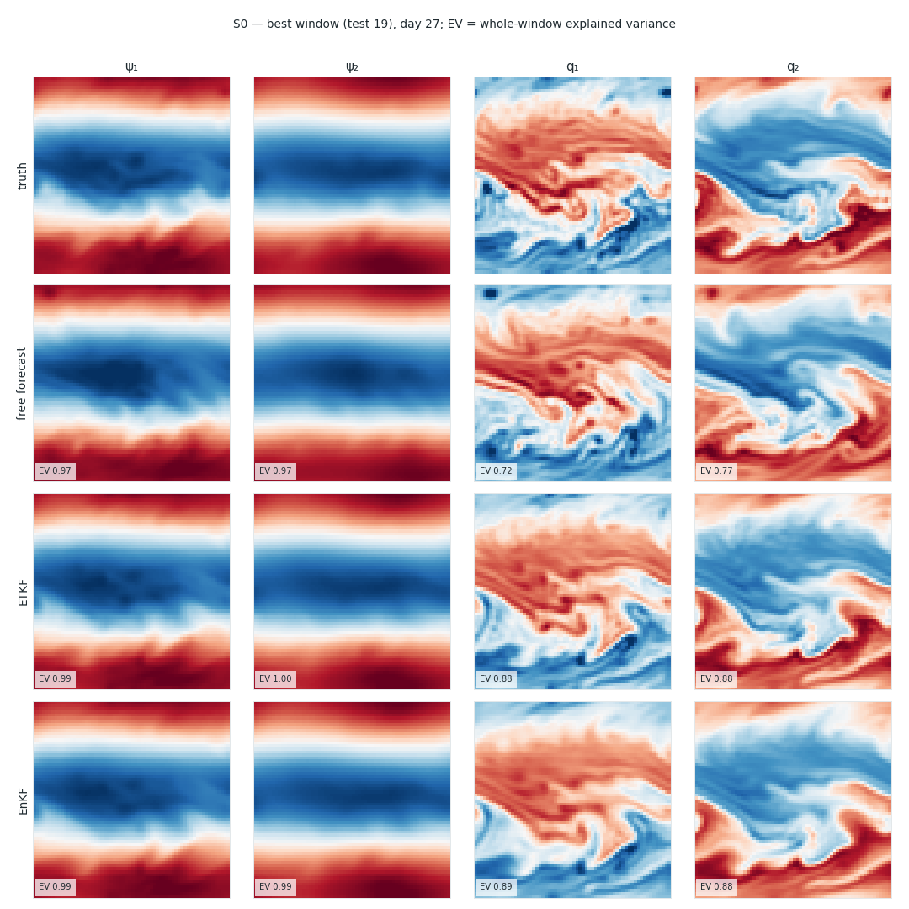

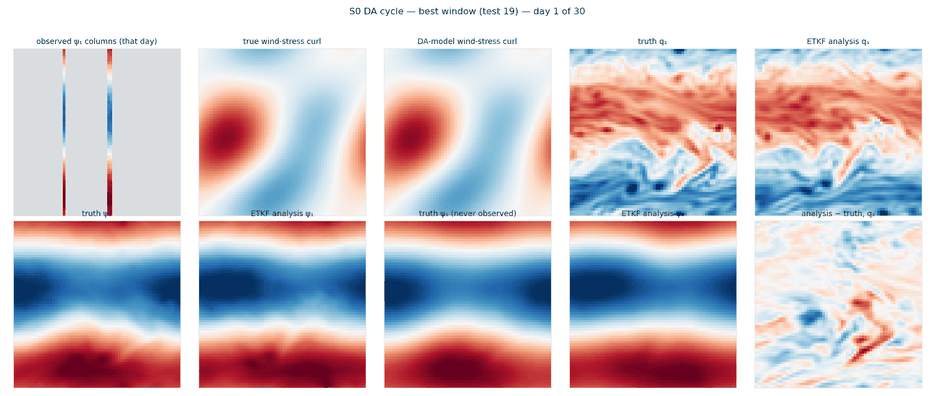

**Median window**

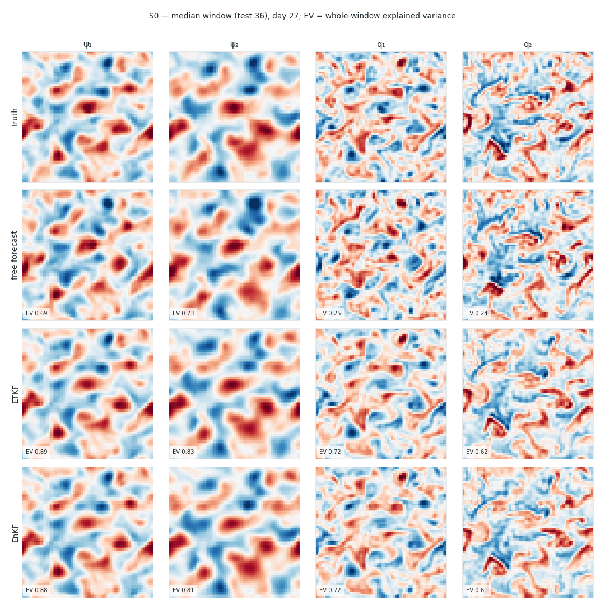

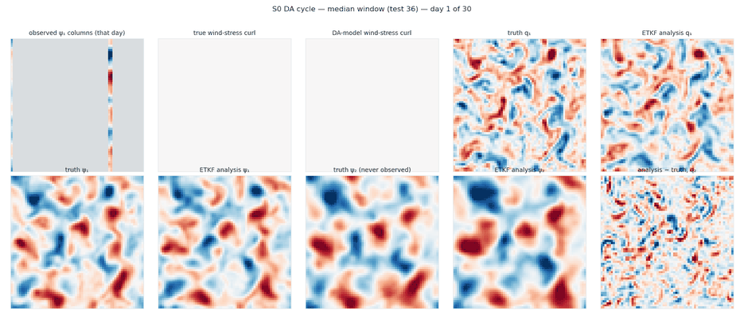

**Worst window**

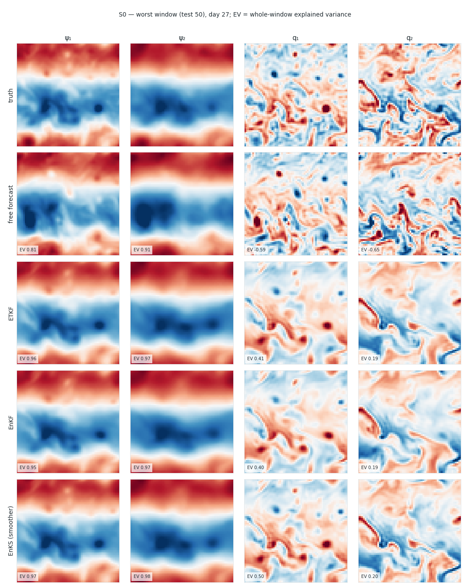

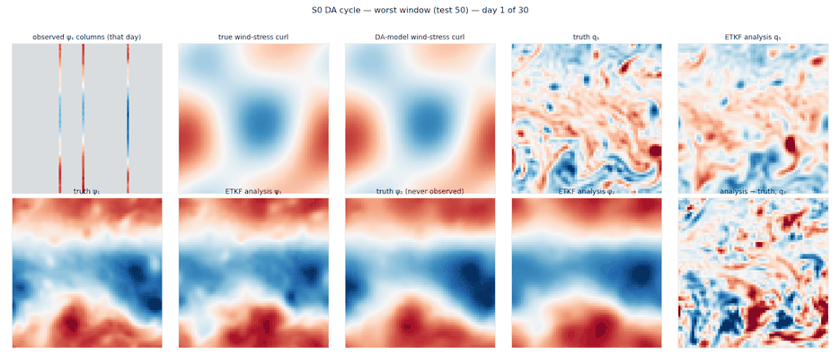

### S1 (realistic base)

**Best window**

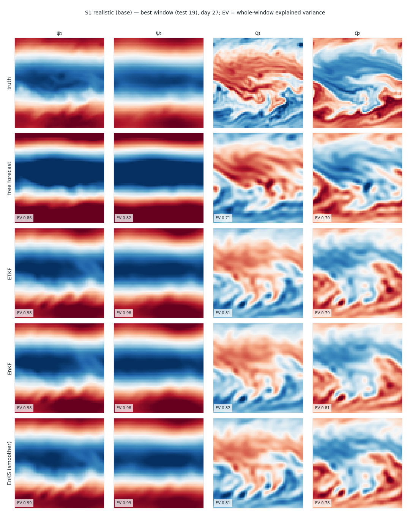

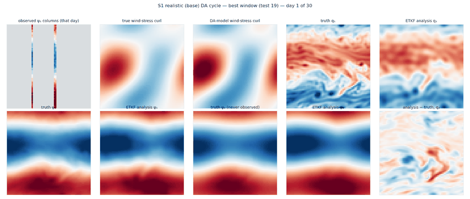

**Median window**

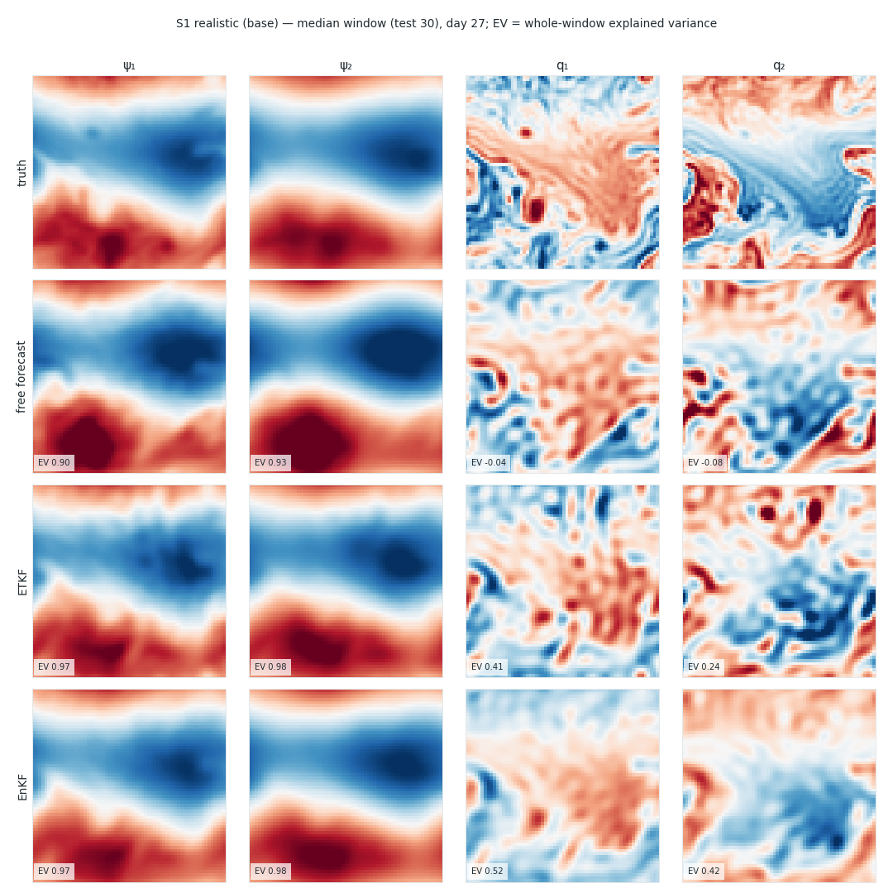

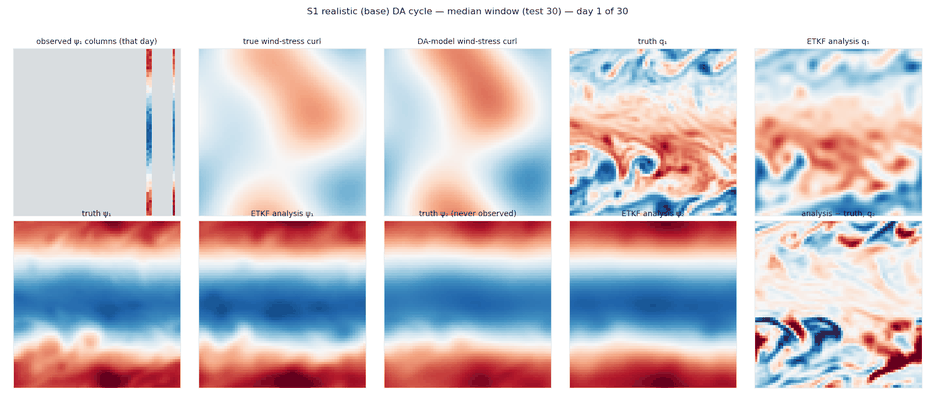

**Worst window**

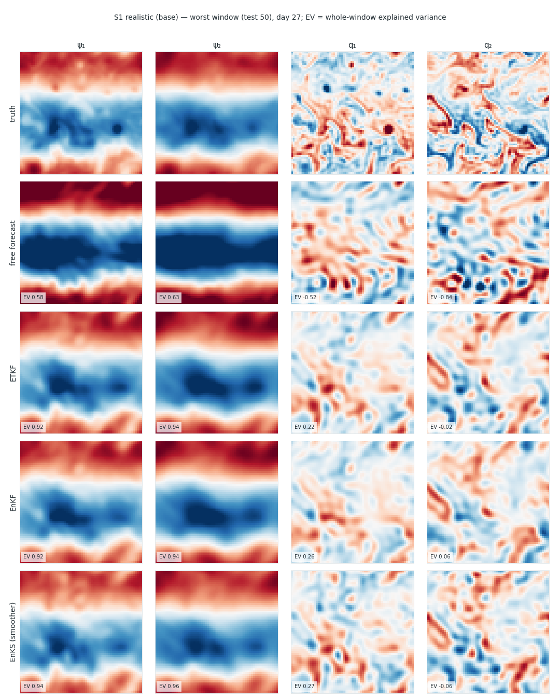

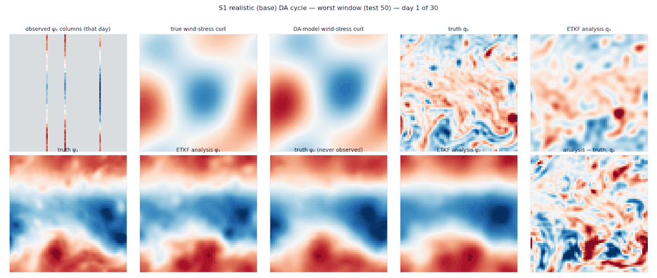

## 9. Neural schemes (forced test set)

Learned reconstructions on the same 100 forced test windows, observation draws and metrics as the DA rows (design: `docs/plans/analysis/qg_specwind_neural.md`; findings, val tuning and ablations: `docs/results/qg_specwind_neural_obs_configs.md`). The networks see only the observations: no initial state, no wind, no ocean parameters. They estimate daily means, cubic-interpolated to the 2-hour DA grid. All are 3D U-Nets (2 space + time) trained on 15-day crops of regenerated forced training windows (the true model), with a random observing system per draw: 3–30 observed (step, column) slots per day drawn with a K^-1.5 tilt towards sparse, and an observation error from the S0 model to the S1 one (white 5–15% plus a per-pass correlated 0–15% of the ψ₁ std; the end-to-end nets and the observation-conditioned flow only, the SDA prior never sees observations). They are applied to the 30-day windows either **stitched** (overlapping 15-day passes) or in one **full-window** pass. One training seed each.

- **G1 DirectUNet** — deterministic end-to-end estimator; M tier (16.8 M parameters) and L tier.
- **G2 CFM** — observation-conditioned flow (M tier, matched to G1-M-3D), 30 members.
- **G3 SDA prior** — unconditional score-based prior (10.0 M parameters) with SDA guided posterior sampling from pure noise, as published (Rozet & Louppe: γ 0.01, 100 steps, 1 corrector, observation σ = the noise level), 30 members. The tier-matched 16.8 M retrain scores the same (within 0.002 at 3 and 12 columns and 15% noise); the S1 row uses it, the old prior was not scored at S1.
- **Hybrid** — the G3 prior's SDA sampler started at τ₀ = 0.5 from an end-to-end estimate (SDEdit), 10 steps, fixed-length normalized guidance step (weight). The G2 warm start uses one CFM sample per member; the G1-L-3D warm start uses its full-window estimate. The G1-L-3D hybrid uses one setting everywhere (τ₀ 0.5, weight 2, selected on val).

DA reference rows (italic, marked DA) are the benchmark ones from sections 2–4 (S1: the S1-tuned ensembles and weak 4D-Var). Unlike the networks, DA starts from the truth lagged about 5 days and runs the exact model (S0) with the true wind. Ranking (bold best, italic second-best) is over all rows; CRPS is ranked over the ensembles only (deterministic rows show the MAE of q); spread/RMSE (median over windows) is not ranked, 1 is calibrated.

**S0, 3 col/day, 5%**

| scheme | ψ₁ | ψ₂ | q₁ | q₂ | score | score 95% CI | CRPS q (×10⁻⁶) | spread/RMSE q₁ / q₂ |
|---|---|---|---|---|---|---|---|---|
| _ETKF (N = 80)_ (DA) | 0.937 | 0.933 | 0.647 | 0.578 | 0.774 | [0.762, 0.786] | 5.875 | 0.72 / 0.90 |
| _EnKS (N = 80)_ (DA) | 0.966 | 0.959 | 0.727 | 0.596 | 0.812 | [0.801, 0.823] | 5.315 | 0.67 / 0.82 |
| _EnKS (N = 320)_ (DA) | 0.977 | 0.965 | 0.776 | 0.645 | 0.841 | [0.831, 0.850] | 4.775 | 0.67 / 0.84 |
| _4D-Var (strong; S1: weak)_ (DA) | 0.978 | **0.983** | 0.752 | 0.648 | 0.840 | [0.826, 0.854] | (6.871, MAE) | — / — |
| G1-M-3D DirectUNet, stitched | 0.984 | 0.970 | 0.837 | 0.691 | 0.870 | [0.866, 0.875] | (5.920, MAE) | — / — |
| G1-M-3D DirectUNet, full window | 0.985 | 0.970 | 0.846 | 0.697 | 0.874 | [0.869, 0.879] | (5.792, MAE) | — / — |
| G1-L-3D DirectUNet, stitched | 0.986 | 0.974 | 0.850 | 0.718 | 0.882 | [0.878, 0.887] | (5.667, MAE) | — / — |
| G1-L-3D DirectUNet, full window | *0.988* | 0.977 | *0.864* | 0.733 | *0.890* | [0.885, 0.896] | (5.435, MAE) | — / — |
| G2-3D CFM, stitched | 0.985 | 0.974 | 0.839 | 0.727 | 0.881 | [0.876, 0.886] | 4.275 | 0.79 / 0.66 |
| G3-3D SDA prior, pure-noise SDA | 0.986 | 0.973 | 0.845 | 0.721 | 0.881 | [0.877, 0.886] | 4.234 | 0.82 / 0.82 |
| hybrid, G2-3D warm start (weight 5; S1: 2) | 0.987 | 0.977 | 0.848 | *0.738* | 0.888 | [0.882, 0.893] | *4.196* | 0.74 / 0.68 |
| hybrid, G1-L-3D warm start (weight 2) | **0.989** | *0.980* | **0.870** | **0.763** | **0.901** | [0.896, 0.905] | **4.089** | 0.57 / 0.52 |

**S1 (realistic base), 3 col/day**

| scheme | ψ₁ | ψ₂ | q₁ | q₂ | score | score 95% CI | CRPS q (×10⁻⁶) | spread/RMSE q₁ / q₂ |
|---|---|---|---|---|---|---|---|---|
| _ETKF (N = 80)_ (DA) | 0.865 | 0.791 | 0.473 | 0.402 | 0.633 | [0.615, 0.650] | 7.364 | 0.87 / 1.10 |
| _EnKS (N = 80)_ (DA) | 0.894 | 0.783 | 0.547 | 0.437 | 0.665 | [0.646, 0.683] | 6.935 | 0.84 / 1.08 |
| _EnKS (N = 320)_ (DA) | 0.897 | 0.791 | 0.557 | 0.456 | 0.675 | [0.657, 0.692] | 6.811 | 0.87 / 1.11 |
| _4D-Var (strong; S1: weak)_ (DA) | 0.897 | 0.797 | 0.480 | 0.273 | 0.612 | [0.582, 0.639] | (10.417, MAE) | — / — |
| G1-M-3D DirectUNet, stitched | 0.973 | 0.959 | 0.757 | 0.620 | 0.827 | [0.821, 0.834] | (7.162, MAE) | — / — |
| G1-M-3D DirectUNet, full window | 0.975 | 0.959 | *0.772* | 0.631 | 0.834 | [0.827, 0.841] | (6.969, MAE) | — / — |
| G1-L-3D DirectUNet, stitched | 0.975 | 0.963 | 0.769 | 0.642 | 0.837 | [0.830, 0.843] | (6.991, MAE) | — / — |
| G1-L-3D DirectUNet, full window | *0.978* | *0.967* | **0.788** | 0.664 | *0.849* | [0.841, 0.856] | (6.713, MAE) | — / — |
| G2-3D CFM, stitched | 0.975 | 0.965 | 0.771 | 0.664 | 0.844 | [0.836, 0.851] | **5.112** | 0.72 / 0.65 |
| G3-3D SDA prior, pure-noise SDA | 0.962 | 0.955 | 0.465 | 0.354 | 0.684 | [0.633, 0.730] | 7.438 | 0.75 / 1.05 |
| hybrid, G2-3D warm start (weight 5; S1: 2) | 0.975 | 0.966 | 0.768 | *0.667* | 0.844 | [0.836, 0.851] | *5.149* | 0.72 / 0.65 |
| hybrid, G1-L-3D warm start (weight 2) | **0.979** | **0.971** | **0.788** | **0.690** | **0.857** | [0.849, 0.864] | 5.275 | 0.48 / 0.47 |

## 10. Observation configurations (neural stress test)

The same networks, not retrained, on denser observations (6 and 12 columns per day) and on noisier or cleaner ones (15% and 2% of the ψ₁ std) at 3 columns per day. 6 and 12 columns and 15% noise are inside the training observing system, 2% is below its error range. The SDA observation σ follows the noise level; the hybrids keep their single setting, except the G2-3D one (weight 5 everywhere but S1). DA reference rows exist only at the reference density and S1 (and the ETKF at 6 columns per day).

**Score (mean EV)**

| scheme | S0, 3 col/day, 5% | S1 (realistic base), 3 col/day | S0, 6 col/day, 5% | S0, 12 col/day, 5% | S0, 3 col/day, 15% | S0, 3 col/day, 2% |
|---|---|---|---|---|---|---|
| _ETKF (N = 80)_ (DA) | 0.774 | 0.633 | 0.817 | — | — | — |
| _EnKS (N = 80)_ (DA) | 0.812 | 0.665 | — | — | — | — |
| _EnKS (N = 320)_ (DA) | 0.841 | 0.675 | — | — | — | — |
| _4D-Var (strong; S1: weak)_ (DA) | 0.840 | 0.612 | — | — | — | — |
| G1-M-3D DirectUNet, stitched | 0.870 | 0.827 | 0.914 | 0.933 | — | — |
| G1-M-3D DirectUNet, full window | 0.874 | 0.834 | 0.911 | 0.927 | 0.847 | 0.879 |
| G1-L-3D DirectUNet, stitched | 0.882 | 0.837 | *0.925* | **0.943** | 0.850 | 0.888 |
| G1-L-3D DirectUNet, full window | *0.890* | *0.849* | 0.924 | 0.939 | *0.862* | *0.896* |
| G2-3D CFM, stitched | 0.881 | 0.844 | 0.922 | 0.939 | 0.856 | 0.884 |
| G3-3D SDA prior, pure-noise SDA | 0.881 | 0.684 | 0.916 | 0.923 | 0.832 | 0.895 |
| hybrid, G2-3D warm start (weight 5; S1: 2) | 0.888 | 0.844 | *0.925* | *0.940* | 0.852 | 0.894 |
| hybrid, G1-L-3D warm start (weight 2) | **0.901** | **0.857** | **0.929** | *0.940* | **0.872** | **0.905** |

**CRPS of q (×10⁻⁶, lower is better; ensembles only)**

| scheme | S0, 3 col/day, 5% | S1 (realistic base), 3 col/day | S0, 6 col/day, 5% | S0, 12 col/day, 5% | S0, 3 col/day, 15% | S0, 3 col/day, 2% |
|---|---|---|---|---|---|---|
| _ETKF (N = 80)_ (DA) | 5.875 | 7.364 | 4.938 | — | — | — |
| _EnKS (N = 80)_ (DA) | 5.315 | 6.935 | — | — | — | — |
| _EnKS (N = 320)_ (DA) | 4.775 | 6.811 | — | — | — | — |
| G2-3D CFM, stitched | 4.275 | **5.112** | 3.321 | **2.756** | **4.911** | 4.174 |
| G3-3D SDA prior, pure-noise SDA | 4.234 | 7.438 | 3.419 | 3.080 | 5.246 | **3.864** |
| hybrid, G2-3D warm start (weight 5; S1: 2) | *4.196* | *5.149* | *3.316* | 2.820 | 5.216 | 3.951 |
| hybrid, G1-L-3D warm start (weight 2) | **4.089** | 5.275 | **3.227** | *2.788* | *4.969* | *3.901* |

**Paired differences** (per-window score differences over the same 100 windows; bootstrap 95% CI). Best end-to-end = the best G1/G2 row in that column.

| config | best end-to-end (score) | hybrid − best end-to-end [95% CI] | pure-noise SDA − best end-to-end [95% CI] | best DA reference (score) | hybrid − best DA [95% CI] |
|---|---|---|---|---|---|
| S0, 3 col/day, 5% | G1-L-3D DirectUNet, full window (0.890) | +0.010 [+0.009, +0.011] | -0.009 [-0.013, -0.006] | EnKS (N = 320) (0.841) | +0.060 [+0.053, +0.067] |
| S1 (realistic base), 3 col/day | G1-L-3D DirectUNet, full window (0.849) | +0.008 [+0.007, +0.009] | -0.165 [-0.212, -0.124] | EnKS (N = 320) (0.675) | +0.182 [+0.163, +0.202] |
| S0, 6 col/day, 5% | G1-L-3D DirectUNet, stitched (0.925) | +0.004 [+0.002, +0.005] | -0.009 [-0.013, -0.006] | ETKF (N = 80) (0.817) | +0.112 [+0.103, +0.120] |
| S0, 12 col/day, 5% | G1-L-3D DirectUNet, stitched (0.943) | -0.002 [-0.003, -0.001] | -0.020 [-0.030, -0.013] | — | — |
| S0, 3 col/day, 15% | G1-L-3D DirectUNet, full window (0.862) | +0.010 [+0.009, +0.011] | -0.030 [-0.036, -0.024] | — | — |
| S0, 3 col/day, 2% | G1-L-3D DirectUNet, full window (0.896) | +0.010 [+0.009, +0.011] | -0.001 [-0.005, +0.003] | — | — |

## 11. Caveats

- 100 test windows per cell; strata have 21–79 windows.
- S1 tuning is a single global R scale for the ensembles and a single model-error scale for weak 4D-Var; relaxation inflation does not beat R × 6, and scale-dependent model error was not tried.
- 4D-Var is deterministic (no spread); its background error is climatological, not cycled.
- The initial state is the lagged truth in both scenarios (optimistic against an analysis-cycled first guess).
- Only S0 has the density curve; S1 was run at 3 columns per day.
- Neural vs DA is not like for like in information: DA gets the lagged truth as its initial state and, in S0, the exact model and wind; the networks get only the observations but were trained on simulations of the true model. In S1 the networks therefore carry no model error (their S1 is the corrupted observations only), so most of the S1 gap to DA is the DA model error, not a better assimilation.
- Neural rows: one training seed each; the hybrid with the G1-L-3D warm start mixes tiers (L-tier warm start, M-tier-size prior), and G2/G3 exist at M tier only.
- The hybrid's ensembles are under-dispersed (spread/RMSE 0.47–0.74); pure-noise SDA is the best calibrated scheme but the weakest in score off the reference case.

